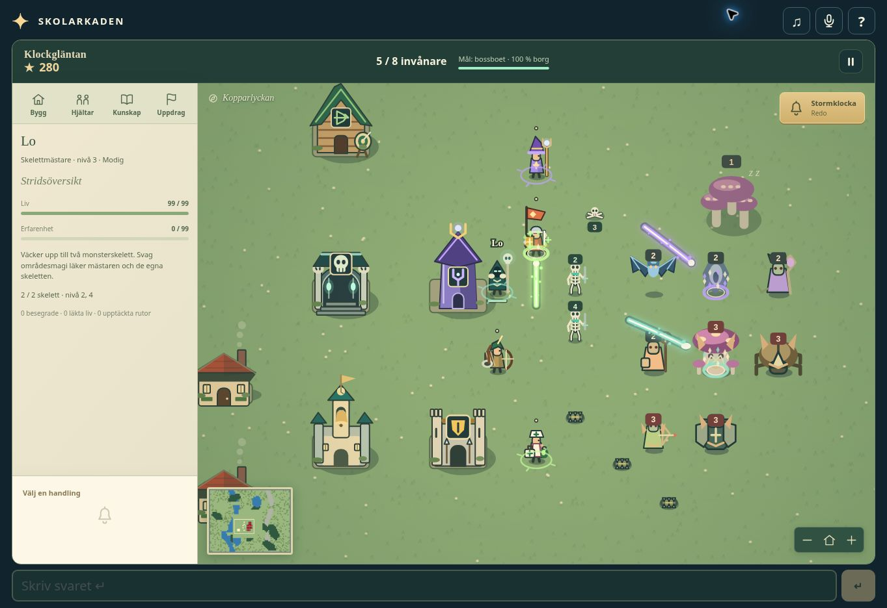
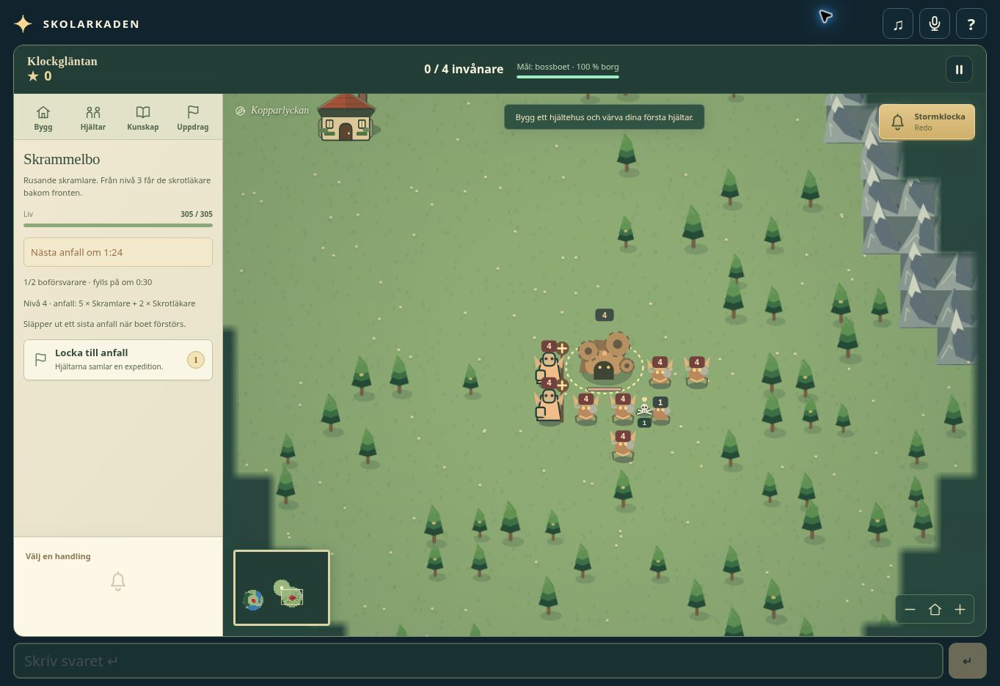
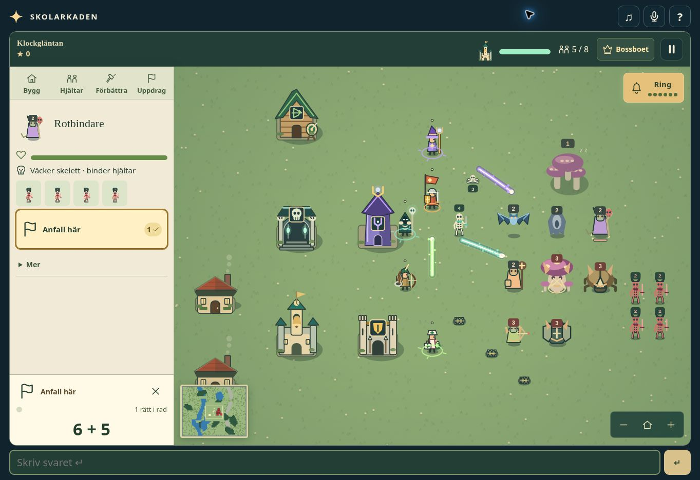
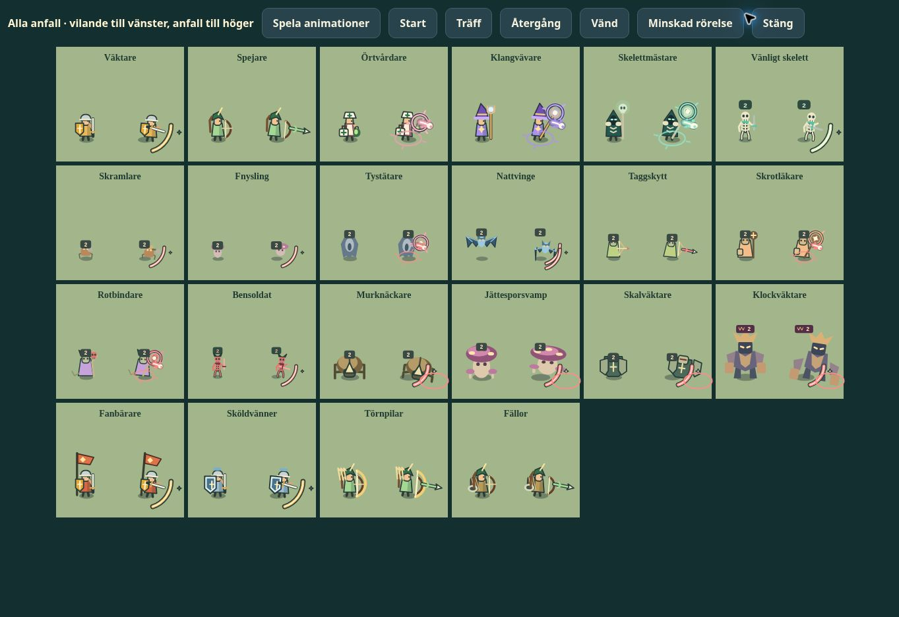
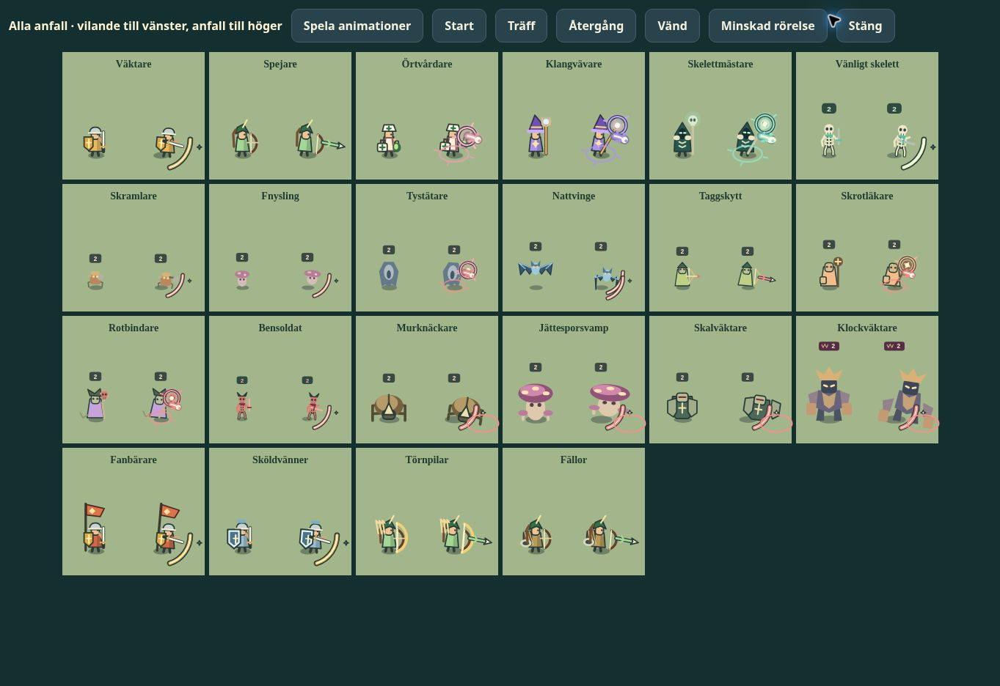

# Klockgläntan — expanded kingdoms

Release changelog, 2026-10-29.

## Opening and world

- Start with only the castle and one house. Build the first guilds and recruit the first heroes yourself.
- Increase both map dimensions by the requested percentage:

| Difficulty | Increase per dimension | Width × height | Boss party guideline |
| --- | --- | --- | --- |
| Easy | +100% (2×) | 72 × 56 tiles | About 10 combined hero levels |
| Medium | +150% (2.5×) | 90 × 70 tiles | About 20 combined hero levels |
| Hard | +200% (3×) | 108 × 84 tiles | About 30 combined hero levels |

- Add blocking rivers, lakes, mountain ridges and dense forests, with bridges and passes connecting the regions.
- Give the empty village time to establish its first guild: the first lair awakens after 120/105/90 seconds on easy/medium/hard.

## Monsters and heroes

- Every lair starts with two defenders that roam around it. Awakening starts separate waves of monsters marching toward the village.
- Each map contains one boss lair with powerful guardians. A level-one hero is in serious danger but can escape; the party guidelines assume healthy heroes with a front line and healing support.
- Communicate danger through monster size, armour, rank marks, guardian crowns and a distinctive boss lair.
- Keep heroes apart and give idle guards patrol routes. Gathering and defending heroes also move between useful positions.
- Fix expedition leaders waiting for companions ahead of them, crowds stuck at shared path waypoints, distant raiders triggering village guards too early, and scouts missing small remaining fog pockets.
- Reveal a lair when its home guardian is spotted, so a retreating scout can still identify the danger.
- Make movement, attacks and healing respect blocked terrain and prevent buildings from sealing the last passage.

## Presentation and sound

- Move the action panel to the left and align it with the answer area. Keep questions and input usable on phone-sized and keyboard-constrained layouts.
- Draw water in distinct blue, with recessed banks and ripples; give mountains and dense forest clear obstacle silhouettes.
- Add 21 original layered sound effects for construction, recruitment, combat, healing, research, warnings, the bell and game outcomes.
- Mix combat by distance and direction, limit simultaneous voices, prioritize exercise feedback and warnings, and reduce sound during voice input.
- Stop sounds reliably on mute, pause, backgrounding and exit; exclude pending sounds from saved games.
- Cache navigation, terrain and fog work for the larger maps. The scouting search chose identical destinations in 96 comparisons while running about 10× faster.

## Saves, review and verification

- Use a separate save schema for expanded kingdoms. Earlier saved games are retained separately; the leaderboard score version is unchanged.
- Complete independent reviews by agents acting as master game designer, visual designer, sound engineer and software engineer, and address their actionable findings.
- Check 90 seeded maps, seven game test domains, shared app integration and desktop/mobile layouts.
- Complete paid-answer campaigns on all three difficulties with no hero deaths and full castle health. Controlled mixed parties defeat bosses at the guideline levels without casualties; half-strength parties retreat.
- Integrate the new checks with the repository's selective test runner and moved test files. All 92 ordinary suites pass after synchronization with current `main`.

See [review evidence and limitations](glantan-review.md), including reproducible balance commands and screenshots. Speaker/headphone audition and physical touch-keyboard testing were not part of the checks.

## Background music — 2026-10-31

- Add an original, quiet woodland theme for soft strings and harp, with a seamless 40-second stereo loop and a gentle fade-in.
- Keep music below exercise feedback; use the existing sound toggle and speech ducking. Pause, backgrounding and game outcomes stop the music, while resume continues the phrase.
- Render locally and cache one music buffer per shared AudioContext, with no downloads, extra playback timers or changes to game balance and saves.

## Visual clarity — 2026-10-31

- Give the nine buildings distinct silhouettes and functional equipment: a fortified shield gatehouse, archery target, herb clinic, violet tuning-fork tower, mounted crossbow, sun lantern and domed bell-tree glasshouse.
- Differentiate all four heroes with stronger outlines and equipment. Healers wear white bonnets and aprons with green medical crosses and carry medicine bags; mages wear pointed violet hats and carry luminous tuning-fork staffs.
- Match guild and hero colours in the action buttons. Use the same healing symbol on the clinic, healer equipment and recruitment controls.
- Increase terrain, architecture and control contrast while retaining the woodland palette; reduce the dark edge vignette.
- Mark every enemy in red on the minimap, distinguish dormant/awake lairs with red shades, and retain the larger boss-lair diamond. Keep tall building and hero silhouettes selectable and hero labels clear of hats.

Validation: all 92 ordinary suites pass. Browser checks cover the complete visual roster at desktop and 390×844 layouts, hero controls and selection on the mage's hat. [Artwork overview](klockglantan-visual-clarity-1793433554156.jpg) shows all building and hero types together in the development-only review scene.

## Combat roles and necromancy — 2026-10-31

- Add **Skelettmästare**, recruited at the new **Benvalv**. Killed monsters leave visible, inspectable bone piles. Each master raises up to two skeletons at the source monster's level; summons follow, fight, retreat with their master and use no housing. Their master's weak area attack heals only that master and its own skeletons.
- Give warriors an exclusive choice between **Fanbärare** (+25% nearby group damage) and **Sköldvänner** (nearby group protection). Banners and warm cloaks distinguish the offensive path; broad blue shields and armour distinguish the defensive path.
- Give rangers an exclusive choice between **Törnpilar** (+40% arrow damage and greater range) and **Fällor**. Longbows and prominent quivers distinguish archers; nets, trap gear and brown equipment distinguish trappers.
- Trappers walk out to lay at most four traps each, 30–70% along an explored route between village and lair. Each trap catches one ground monster, deals `14 + 6 × ranger level at placement` damage and immobilizes it for 2.8 seconds (1.2 for boss guards). Surviving traps are collected after their lair falls.
- Replace faint magic bolts with layered cast runes, bright trails, impact rings and sparks, with separate colours for friendly magic, healing, soul magic and enemy spells. Reduced-motion rendering retains clear static attack links and impacts.
- Win immediately when **Tystnadens hjärta**, the boss lair, is destroyed. Other nests and surviving monsters no longer require cleanup. The HUD, help and boss inspection explain the objective.
- Select three of five enemy families per map. Eleven monster types, including boss guardians, have distinct silhouettes, level badges and inspectable role descriptions. Flyers cross obstacles and require arrows, magic or towers; warriors, skeletons and ground traps cannot hit them.
- Upgraded lairs immediately release mixed waves: melee + healer, mushrooms + brood-spawning giant, ranged magic + immobilizer, flying attacks + siege creature, or ranged thorns + armoured escort. Charging, kiting, healing, rooting, building attacks and bounded brood growth give the families different tactics.
- Give stronger mixed waves time to regroup between attacks. Enemy roots leave a short movement window so multiple binders cannot hold one hero forever.
- Preserve existing version-two saves and in-progress exercise purchases. Former hammer and scouting branches migrate to Fanbärare and Fällor without losing the held question or partial payment.

Validation: 93 ordinary test suites; 90 deterministic maps; focused ownership, life-drain, trap, flight, support-role and victory checks; controlled boss parties at 10/20/30 combined levels. Browser checks cover both branch appearances, active combat, skeleton inspection, and a complete three-answer necromancer recruitment at 390×844.

Final paid-answer campaign probes (seeds 0–2, one correct answer per 10 seconds):

| Army / difficulty | Wins | Duration | Fallen heroes |
| --- | ---: | --- | ---: |
| Necromancer + trapper, easy | 3/3 | 15:34–18:55 | 0 |
| Standard mixed army, medium | 3/3 | 17:00–20:26 | 0–3 |
| Larger mixed army + beacon, hard | 3/3 | 26:01–37:02 | 1–15 |

These are deterministic automated strategies, not universal completion times. Hard maps can require resurrection and rebuilding. Reproduce with `node dev/glantan-balance.cjs steady 10 0 1 2`, `node dev/glantan-balance.cjs brave 10 0 1 2`, or `GLANTAN_SPECIALISTS=1 node dev/glantan-balance.cjs gentle 10 0 1 2`.

## Lair waves and replenishing guardians — 2026-10-31

- Lair levels 1–4 now send respectively **2 basic**, **3 basic**, **4 basic + 1 advanced**, and **5 basic + 2 advanced** monsters. Tier-three lairs add one basic monster to every wave. Family descriptions and the inspection panel show that advanced units arrive at level three.
- Destroying an ordinary lair releases one final wave at its current level and tier. A lethal opening hit does not also release an awakening wave. Destroying the boss still wins immediately without releasing monsters. If the monster cap is full, the final wave's remaining members wait for free slots and survive save/resume.
- Living lairs check every 30 seconds and replace missing guardians up to their initial garrison size, even while dormant. Surviving guards are neither healed nor replaced. Replacement ordinary guards use the lair's current strength; ruined lairs never replenish.
- New games start with **5/7/9 lairs**, including the boss, and **1/2/3 boss guardians** on easy/medium/hard. Ordinary lairs retain two guards. The easy boss remains tier three. Reserve enough monster slots for all hard-mode garrisons and the two possible spreading nests.
- Boss expedition readiness now accounts for the actual initial guardian count. The hard boss warning explains the armour, banner and group-healing preparation behind its roughly 30-level recommendation.
- Lair inspection shows exact wave composition, current/maximum guardians, the replenishment countdown when guards are missing, and a warning about the final wave.
- Existing saved maps and their original garrison sizes are preserved; start a new game to receive the new initial lair and boss-guardian counts. Wave and replenishment rules also apply to resumed games. Wave intervals, growth timers and per-monster difficulty stats are unchanged.

Validation: **93/93 ordinary suites passed**, including 90 seeded maps, every family/tier/level wave composition, dormant and awake replenishment, no overfilling or survivor healing, destruction-wave cap handling, boss victory, and saved timers/queues. Browser checks covered 1/2/3 boss garrisons and desktop/mobile lair inspection. The six controlled boss probes passed; the hard target-level party uses armour, banners and group healing. The same 30-level hard party without those upgrades failed in an exploratory probe.

The requested changes materially increase medium/hard pressure. Paid-answer campaign probes on seed 0, using the existing fixed strategy:

| Difficulty | Seconds per correct answer | Outcome | Game time | Fallen heroes |
| --- | ---: | --- | ---: | ---: |
| Easy | 10 | Won | 14:55 | 2 |
| Medium | 10 | Lost | 15:57 | 12 |
| Hard | 10 | Lost | 18:08 | 17 |
| Medium | 5 | Won | 9:10 | 1 |
| Hard | 5 | Won | 39:24 | 32 |

These are limited automated balance probes, not general win-rate estimates or required answer speeds. They supersede the earlier campaign results above for the new rules. Reproduce with `node dev/glantan-balance.cjs <gentle|steady|brave> <5|10> 0`; use `--boss` for the controlled encounters.

## Picture-led interface — 2026-10-31

- Replace decorative headings, repeated totals and routine success prose with short labels and visual feedback. Keep longer descriptions, precise statistics and fantasy names under **Mer**.
- Reuse the actual building, hero and monster artwork in purchase cards, selections, wave previews, guardians and summon slots. Building cards show the hero they unlock; healer and mage cards state their different roles.
- Enlarge labels and touch targets. Reflow phone controls across the full panel width, preserve the question and input in reduced-height views, and remove the rules that hid important descriptions on small screens.
- Show exclusive hero upgrades side by side under **Välj en**, with the upgraded appearance, a short effect description, a completion mark and a lock on the competing path. Present all three competing eight-answer choices together.
- Show answer progress as filled circles beside the selected purchase picture. Keep exercise hints, answer matching and streak rules intact. Placement uses a ghost building, marked blocked tiles and a tick/cross, with no placement instructions or obstruction prose.
- Give lairs illustrated wave counts, guardian slots and separately identified timers. Show the destruction wave graphically, without warning text. Keep the boss victory goal explicit.
- Show health, experience, hero status, owned skeletons and traps visually; expose detailed statistics on demand. Keep the flying-enemy counter clear.
- Use **Anfall här**, **Vakta här** and **Utforska här** consistently. Show gathering parties and actionable shortages. Locate important warnings on the map/minimap and let players tap the notification to go there.
- Simplify the castle/population HUD and bell charge display. Replace the long game help with illustrated steps, move result statistics under **Mer**, and use **Du vann!** / **Borgen föll.** Keep restart and public-name consequences clear. No spoken UI help was added.

Validation: all 93 ordinary suites pass. Browser checks cover building placement (valid and blocked), a completed four-answer upgrade and its mutually exclusive lock, necromancer slots, lair waves, illustrated help, and 390×844 / 390×500 layouts. The reduced-height view models available keyboard space; no physical touch keyboard was used. [Interface example](klockglantan-readable-ui-1793473044549.jpg).

## Summons, coordinated waves and smoother movement — 2026-10-31

- Limit each **Skelettmästare** to **one** living skeleton. Existing saves retain that master's strongest skeleton. Summon slots and role descriptions reflect the new limit.
- Give healers a shared recovery timer for healing and attacks. Healing prevents an immediate attack and attacking postpones healing. A level-one healer can no longer independently heal and attack its way through the tested three-monster groups on easy.
- Keep each mixed wave together until it encounters a target or takes damage. The slowest member leads, waits for stragglers and guides flying escorts through the same terrain passages. Once combat starts, each monster resumes its individual movement and tactics.
- Remove unclaimed monster corpses after **45 game seconds**, including expired corpses in resumed games. Both friendly and enemy raisers consume the same finite corpse supply.
- Give the advanced **Rotbindare** the ability to raise up to **four Bensoldater**, one every four seconds. Enemy skeletons have coral-red bones, dark scarves and small horns; friendly skeletons stay white. Enemy skeletons inherit the corpse's level, remain near their caster and collapse when it dies. Killed skeletons leave no reusable corpse.
- Interpolate unit positions and spell animation between simulation ticks. Cache frequently used routes, reduce allocations during pathfinding, skip unchanged minimap frames and offscreen effects, and replace repeated spell blurs with layered luminous strokes.
- Fix a line-of-sight error at exact grid edges that could stall a wave at the castle despite a clear approach.

Validation: **93/93 ordinary suites passed**, including summon limits and ownership, save migration, corpse expiry, healer cooldowns in both directions, mixed ground/flying waves taking a river detour, combat release and terrain visibility. Browser inspection confirmed one friendly summon slot, four enemy summon slots, distinct skeleton artwork and visible spell effects.

All six controlled boss probes pass. The medium target-level party now uses five level-four heroes, including two healers; the previous four level-five heroes with one healer did not clear the encounter after the shared cooldown change. Boss stats are unchanged. These are controlled party examples, not general win-rate estimates.

CPU benchmark on the same machine, comparing `f919ced` with this release, with 24 heroes and 83 monsters:

| Scene | Mean simulation tick before | After | Reduction | 95th percentile before → after |
| --- | ---: | ---: | ---: | ---: |
| Marching | 4.431 ms | 2.681 ms | 39% | 7.722 → 3.743 ms |
| Battle | 5.011 ms | 3.694 ms | 26% | 7.116 → 5.155 ms |

Reproduce with `node dev/glantan-performance.cjs --ref f919ced` and `node dev/glantan-performance.cjs`. Each scene discards three warm-up runs, then samples 500 ticks. The development review page also includes a six-second drawing probe. These timings measure simulation CPU work; this environment did not provide a reliable device frame-rate measurement.

## Visible attacks for every unit — 2026-10-31

- Animate every hero class and all twelve monster types, including friendly and enemy skeletons, boss guardians and both warrior/ranger upgrade paths. Warriors and skeletons swing their swords; archers draw and release their bows; magic users gesture with their hands or staffs and light up at the casting point.
- Give monsters readable physical attacks: metal-fist jabs, mushroom hops and compression, folding-wing dives, siege lunges, shield bashes and heavy guardian slams.
- Replace the small target-only melee arc with a directional, outlined sweep and impact spark. Heavy hits add a ground ring; flying attacks use paired claw trails. Arrows have contrasting shafts, heads and fletching.
- Trigger poses from actual attacks, healing and summoning. Retain the action's direction through follow-through even if the target dies or the attacker starts moving away. New and idle units do not show false attacks. Damage, cooldowns and movement rules are unchanged.
- Preserve brief static attack poses and clear source/target effects under reduced motion. Keep inspection portraits still. Use the existing animation loop and inexpensive canvas geometry, without extra production timers or blur filters.

Validation: **93/93 ordinary suites passed**. Combat checks exercise actual attacks by every class and monster type, friendly skeleton attacks and cooldowns without repeated animation triggers. Browser checks cover the complete roster, both facing directions, reduced motion and a live mixed-unit fight. The development-only **Alla anfall** control compares idle and attacking poses, with playback and individual phase controls.

## Level indicators clear of heads — 2026-10-31

- Place each monster's level badge above its full physical silhouette, accounting for the label's own height, unit scale, higher-rank horns, crowns and attack motion. Keep the label steady through the animation, with a clear gap below it.
- Give friendly and enemy skeletons the same clearance. Fit inspection portraits and summon slots using the corrected badge bounds, so neither heads nor labels are clipped.

Validation: **93/93 ordinary suites passed**. Browser checks cover all monster types in idle and attack poses, stronger monsters in the combat scene, and the necromancer/binder portraits and summon slots.

