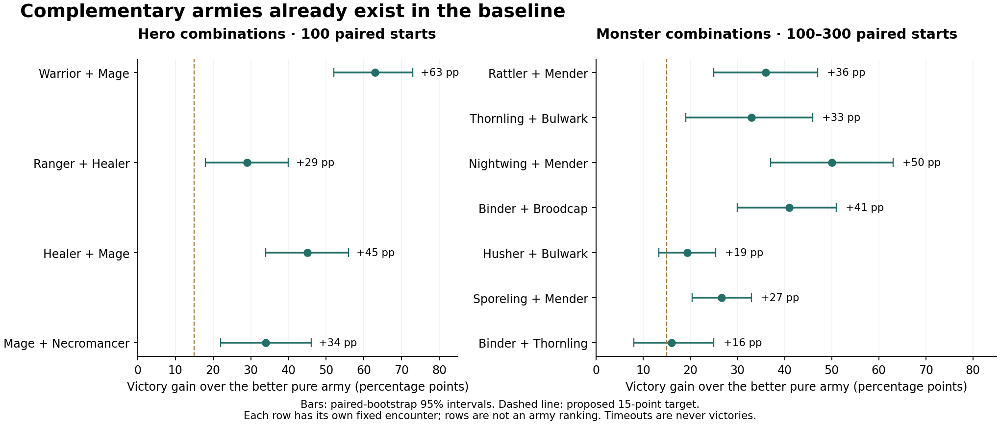
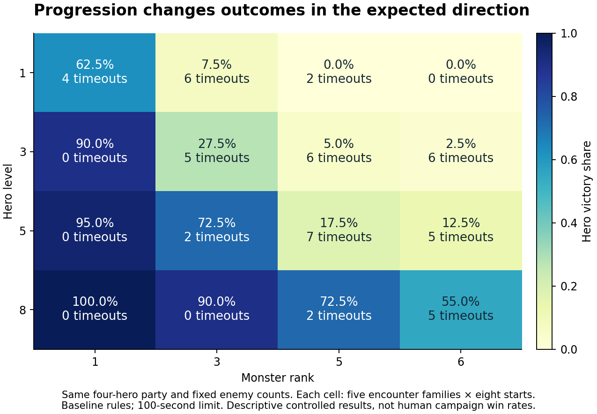

# Klockgläntan: reproducible combat balance study

2026-11-01–02. Baseline: `28ba8b8a447182e495ae869777539f4d6abe363d`.

The retained game change gives the siegebreaker a clearer role: fragile,
dangerous to buildings, stoppable by nearby defenders, and useful with mender
escorts. In 100 fresh defended-castle starts, siege + mender armies breached
30 times versus once for pure siege and never for pure menders. The original
rules produced six breaches for both mixed and pure-siege armies.

The baseline already has substantial complementary army composition. All five
hero classes have a confirmed partner. The initial monster partnership screen
covers all ten ordinary types after the siege change, but some of those results
fail the later independently calibrated comparisons below. Seven calibrated
partnerships cover nine ordinary monster types; broodcap remains unresolved.
Nine types also meet the observed strong/weak counter targets, although the
bulwark weakness has wider uncertainty. The all-ranger campaign advantage is partly an acquisition-cost
advantage; an all-ranger loss also appears on the second hard-mode map seed.
The original anecdotes alone did not justify a ranger nerf.

The [protocol](glantan-combat-protocol.md), actual-engine runners and
[archived evidence](glantan-combat/manifest.json) make those findings replayable.
Each experiment distinguishes victories, defeats and timeouts. The study does
**not** establish that every unit has passed every proposed acceptance condition,
or estimate human campaign win rates.

## Retained change: siegebreaker with escorts

Base HP changes from 165 to 90 and building damage from 23 to 42. A live hero
or friendly skeleton within 1.6 tiles and line of sight intercepts the engine;
its retaliation deals 35% of building damage on the same action cooldown.
The fragile engine therefore benefits from menders keeping it alive. The
near-constant HP × building-damage product was a tuning starting point, not
evidence of equal combat power. Expedition readiness uses its lower antihero
damage. Existing saves adopt the new stats while preserving health fraction,
position and action timers; dead units remain dead.

The confirmatory encounter uses rank-3 monsters against a level-3 warrior,
healer, mage and necromancer defending a 1,000-HP castle. Castle fire is active;
party death does not end the battle. The objective is a breach within 75 seconds.
The frozen armies are four siege + two menders, six siege, or eight menders.
Their nominal budgets are 15.552, 17.280 and 16.128: both pure controls spend
more than the mixture. These are monster victories, not hero victories.

| Siege rules | Mixed breaches | Pure siege breaches | Pure mender breaches | Mixed win/loss/timeout |
| --- | ---: | ---: | ---: | --- |
| [Original: 165 HP / 23 damage](glantan-combat/data/enemy-siege-final-original.json.gz) | 6% | 6% | 0% | 6 / 94 / 0 |
| [Interception only: 165 / 23](glantan-combat/data/enemy-siege-final-interception.json.gz) | 0% | 0% | 0% | 0 / 100 / 0 |
| [Retained: interception, 90 / 42](glantan-combat/data/siege-production-validation.json.gz) | 30% | 1% | 0% | 30 / 69 / 1 |

The retained mixture's advantage over the stronger pure army is **29 percentage
points**, paired-bootstrap 95% interval **20–38**. Its advantage over the
original mixed army is 24 points, interval 13–35. Unsupported siege loses
99/100 encounters, demonstrating a decisive vulnerability. Pure menders have
100 timeouts, which are not defeats. This confirms a useful partnership in one
frozen context, not a universally superior army or a 75% favorable matchup.

The integrated production code reproduced all 300 candidate trial records
exactly apart from wall-clock execution time. The
[confirmation record](glantan-combat/enemy-siege-final-confirmation.json),
[frozen protocol](glantan-combat/enemy-siege-final-confirmation-protocol.json)
and compressed per-trial evidence preserve the comparison. The earlier
interception-only source is retained as a
[replay patch](../dev/experiments/glantan-siege-interception.patch).

A separate cost-sensitivity check preserves the mixed army and defender while
funding pure controls with independently fitted reference equivalents. The
first fit had mismatched training/validation formation coverage; its fresh
check failed: **32% mixed versus 43% for eight siege and 0% for five menders**.
That failure is retained in the [v1 record](glantan-combat/siege-calibrated-summary.json).

The corrected fit uses the full distance × spacing × mirror distribution
before freezing its prices. It funds six pure siege or seven pure menders
against the same four siege + two menders. On another 100 fresh starts the
mixture wins **37% versus 1%/0%**, a **36-point gain, paired 95% interval
27–46**. The mixed and pure-siege armies have no timeouts; pure menders have
91 timeouts and nine defeats. Both checks use the same production code.
See the [v2 result](glantan-combat/siege-calibrated-v2-summary.json) and
[frozen controls](glantan-combat/siege-calibrated-v2-protocol.json).
The mender equivalent was learned with rattlers, and the siege equivalent in
a separate castle assay; transferring these values remains an explicit
sensitivity assumption, not proof of a universal unit price.

A further 908 fixed-case regressions cover the affected baseline core, level
and progression suites. In the 270 pure-siege core cases, hero victories rise
from 187 to 234; unsupported siege is deliberately easier to stop. In 270
nightwing/siege core cases, hero victories change from 194 to 197. Average
castle damage falls in both families. These use the original objective-pressure
proxy controls (castle fire off, party death can end combat), so they are not
pooled with the defended-castle confirmation. Full before/after counts are in
[siege-regression.json](glantan-combat/siege-regression.json).

## Confirmed hero partnerships

These use 12 recruitment-cost points at hero level 3. A mixture spends half on
each class: for example, three warriors plus two mages replace either six
warriors or four mages. Guilds and research are excluded from this marginal
combat comparison. Each row uses 100 fresh, paired starting conditions against
one fixed enemy roster; different rows are not directly comparable rankings.

| Combination | Encounter | Mixed victories | Pure A | Pure B | Gain over stronger pure army | Paired-bootstrap 95% interval |
| --- | --- | ---: | ---: | ---: | ---: | ---: |
| Warrior + mage | Bulwarks, nominal ratio 1.3 | 92% | 11% | 29% | +63 points | +52 to +73 |
| Ranger + healer | Husher/binder wave, ratio 1 | 79% | 50% | 0% | +29 points | +18 to +40 |
| Healer + mage | Thornling/bulwark wave, ratio 0.7 | 76% | 0% | 31% | +45 points | +34 to +56 |
| Mage + necromancer | Shielded mixed wave, ratio 1 | 70% | 36% | 18% | +34 points | +22 to +46 |

All four beat both pure controls in paired tests and exceed the proposed
15-point practical target. They do not imply that the combination is better
against every enemy. In particular, warrior + healer against the tested
bulwarks won 21%, versus 11%/0% for its controls: that discovery did **not** meet
the 15-point target on confirmation. An upgraded warrior + ranger candidate
also failed confirmation (82% versus 35%/79%). Failed candidates remain in the
evidence instead of disappearing from the report.

Fresh counter checks establish several decisive hero matchups at nominal ratio
1. Each listed ordinary solo-class result has 100 starts. Support is assessed
by its contribution to a functioning army.

| Hero | Favorable evidence | Unfavorable evidence |
| --- | --- | --- |
| Warrior | 100 victories against hushers | 98 defeats, 2 timeouts against nightwings |
| Ranger | 100 victories against sporelings | 90 defeats against thornlings |
| Healer | Healer + mage: 76 victories versus 31 for pure mages at the same recruitment budget | 99 defeats, 1 timeout against guardians |
| Mage | 100 victories against sporelings | 98 defeats against thornlings |
| Necromancer | 100 victories against sporelings | 100 defeats against guardians |

The healer's favorable result is a team contribution, not evidence that a
healer-only army should win. The summon-using classes were tested both with
natural corpse generation and, in separately labelled probes, seeded remains.

## Independently calibrated comparisons

The initial monster weights are a useful first screen, but some partnerships
vanish when their pure controls receive a better-founded budget. The v2 study
fits reference equivalents before testing counters and synergies. It uses
three fixed level-3 hero armies costing 12, 18 training starts covering the full
distance × spacing × mirror distribution, and 36 fresh validation starts.
Pure-type prices come from the count giving 50% actual monster victories;
support prices come from replacing part of a functioning anchor army. The
75% counter and 15-point synergy targets never enter the fit.

These are rank-3 reference equivalents, not purchase prices or the earlier base
threat scale. Support prices remain conditional on their anchors, and siege is
measured in a defended-castle assay. Transferring them is an explicit assumption.

| Type | Rank-3 reference cost | Context |
| --- | ---: | --- |
| Rattler | 0.386 | Three reference armies |
| Sporeling | 0.304 | Three reference armies |
| Husher | 1.205 | Three reference armies |
| Nightwing | 0.450 | Three reference armies |
| Thornling | 1.026 | Three reference armies |
| Broodcap | 1.125 | Three reference armies |
| Siegebreaker | 1.340 | Defended castle |
| Mender | 1.275 | With rattler |
| Binder | 3.692 | With thornling |
| Bulwark | 2.313 | With husher |

Mean absolute held-out reference prediction error is **5.3 percentage
points**; thornlings have the largest error, 13.9 points. This describes the
reference average, not individual matchups: counter-panel prediction errors
are much larger. The earlier v1 fit trained on only one spacing and failed its
geometry-shifted validation; its model and failed siege sensitivity remain in
the archive. The v2 fit fixes that distribution mismatch before confirmation.
See the [frozen model summary](glantan-combat/calibration-v2-summary.json).

Each row below combines two separately selected, freshly confirmed contexts.
Each context has 100 starts. A weak matchup requires actual opposing victories;
remaining outcomes are defeats or timeouts, never automatically wins.

| Monster army | Favorable opponent: monster victories | Unfavorable opponent: hero victories |
| --- | --- | --- |
| 31 rattler | 6 warriors: 100% | 4 mages: 100% |
| 39 sporeling | 3 rangers + 2 healers: 96% | 3 warriors + 2 mages: 100% |
| 10 husher | 6 rangers: 100% | 6 warriors: 99% |
| 27 nightwing | 6 rangers: 100% | 3 warriors + 2 mages: 98% |
| 12 thornling | 3 rangers + 2 healers: 100% | 3 warriors + 2 mages: 98% |
| 11 broodcap | 6 warriors: 100% | Unresolved |
| 9 siegebreaker | 3 rangers + 2 healers: 100% | 4 mages: 100% |
| 24 rattler + 2 mender | 6 warriors: 100% | 4 mages: 100% |
| 8 thornling + 1 binder | 4 healers: 100% | 3 warriors + 2 mages: 100% |
| 8 husher + 1 bulwark | 6 rangers: 100% | 3 warriors + 2 mages: 77% |

The bulwark army's 77% defeat rate has a nominal Wilson 95% interval of
67.8–84.2%; it meets the point target but does not yet establish a population
rate above 75%. Other confirmed directions clear that lower-bound check.
Mender, binder and bulwark rows are army-role checks, not pure-support duels.
Broodcaps remain the counter gap in this version: a subsequent complete screen
of all 46 cost-12 hero compositions found at most 9/18 hero victories, below its
predeclared confirmation gate. Its full [screen](glantan-combat/brood-composition-summary.json)
is retained rather than treating a low brood victory share as a decisive loss.

## Current partnerships at calibrated budgets

All rows use 100 fresh paired starts per arm. Pure controls spend at least the
mixture's achieved budget. Their listed victory rates are monster victories.
The [acceptance matrix](glantan-combat/acceptance.json) includes actual budgets,
opponents, both paired tests and every failed confirmation.

| Mixture | Pure control counts | Mixed wins | Pure A wins | Pure B wins | Gain, nominal 95% interval |
| --- | --- | ---: | ---: | ---: | --- |
| 24 rattlers + 2 menders | 31 rattlers / 10 menders | 58% | 39% | 1% | +19 points, +6 to +32 |
| 8 hushers + 1 bulwark | 10 hushers / 6 bulwarks | 100% | 60% | 3% | +40 points, +31 to +50 |
| 11 thornlings + 5 bulwarks | 23 thornlings / 10 bulwarks | 69% | 31% | 0% | +38 points, +24 to +51 |
| 22 sporelings + 3 hushers | 34 sporelings / 9 hushers | 26% | 1% | 0% | +25 points, +16 to +34 |
| 15 sporelings + 2 binders | 40 sporelings / 4 binders | 50% | 2% | 0% | +48 points, +38 to +58 |
| 21 nightwings + 2 menders | 27 nightwings / 10 menders | 85% | 50% | 0% | +35 points, +23 to +47 |
| 4 siege + 2 menders | 6 siege / 7 menders | 37% | 1% | 0% | +36 points, +27 to +46 |

The contexts differ: these rows establish useful partnerships, not rankings or
universally winning compositions. The rattler mixture times out in 18% of
starts and the nightwing mixture in 5%; the other listed mixtures have no
timeouts. Several pure mender controls mostly time out. The separate counter
criteria ensure that a modest synergy win rate is not mistaken for a decisive
favorable matchup.

All seven pass the original batch criteria and a broader Holm sensitivity
check across all **13 calibrated confirmations / 26 paired comparisons**,
including the failures. This broader check is explicitly post hoc; the
predeclared batch corrections remain in the archived protocols. Confidence
intervals in the table are nominal, not simultaneous.

Failed fresh confirmations include binder + thornling (+4 points), sporeling +
mender (+6), broodcap + mender (+13), nightwing + binder (−10), nightwing +
bulwark (+4), and broodcap + bulwark (−2). Brood + bulwark's exploratory
16.7-point gain did not reproduce: 66% mixed victories versus 68% for pure
broodcaps. No failed row was silently replaced by its discovery result.

The nightwing result illustrates why mixture ratios matter. Under the new
prices, an earlier mender-heavy army did not improve on pure nightwings.
Reducing menders to 21.25% of the achieved budget produced the confirmed
35-point advantage without changing either unit.

## Historical monster partnerships at initial weights

All these results use fresh validation seeds, real combat AI and rank-3
monsters. The pure controls spend at least the achieved mixed nominal threat
budget, rounded upward by less than one unit. Initial threat weights were
frozen before tuning; they are provisional because monsters have no purchase
price in the game. Full achieved counts, budgets and hero opponents are in
[analysis.json](glantan-combat/analysis.json).

| Combination | Starts per arm | Mixed victories | Pure A | Pure B | Mixed timeouts |
| --- | ---: | ---: | ---: | ---: | ---: |
| Rattler + mender | 100 | 42% | 6% | 0% | 56% |
| Thornling + bulwark | 100 | 60% | 27% | 0% | 0% |
| Nightwing + mender | 100 | 74% | 24% | 1% | 26% |
| Binder + broodcap | 100 | 52% | 6% | 11% | 0% |
| Husher + bulwark | 300 | 31.3% | 12.0% | 0.3% | 0.7% |
| Sporeling + mender | 300 | 42.0% | 15.3% | 2.3% | 22.7% |
| Binder + thornling | 100 | 88% | 0% | 72% | 0% |

The husher/bulwark and sporeling/mender rows used separate 300-start confirmation
after borderline initial 100-start results. They pass both that batch's
two-context correction and the broader Bonferroni check across all 18 reported
baseline monster confirmations (36 paired comparisons, alpha 0.00139 each).
The natural binder + broodcap result started with **no corpses**:
the brood supplies bodies during combat and the binder can use their remains.
Its mixed budget was 17.136, versus 19.008 and 18 for the pure controls.

These are conditional advantages, not universal dominant armies. A 42% victory
rate with 56% timeouts is a real advantage over 6% but remains a poor example
of decisive combat. The timeout problem is recorded separately from synergy.

The original sporeling + broodcap, husher + binder, and guardian + bulwark
discoveries failed their first fresh validation. Broodcaps already generate
sporelings themselves, so simply adding more sporelings is often redundant.
Binder raising works and consumes the same action slot as its root attack;
missing synergy was not evidence that its summoning code never ran.

Boneservants are created by binders rather than bought independently. Guardians
are boss garrisons rather than ordinary escort units. Their acceptance checks
therefore cover ownership, corpse consumption, caps and master death, or actual
boss nests, respectively. This is an explicit improvement to the original
all-types pairing requirement; it is not a claim that fictional standalone
boss/summon partnerships passed it.

## Progression and cost

Holding the four-hero composition and enemy counts fixed, increasing hero level
improves victory share and increasing monster rank reduces it in the tested
grid. Each cell combines five encounter families and eight starting conditions.

This supports the direction of progression. It does not validate a universal
power price. The initial monster weights overestimate some basic creatures
relative to ranged/support threats: in the pilot, a reference party could
handle many more rattlers/sporelings than hushers or bulwarks. A single scalar
budget cannot represent counters, corpse availability, healing saturation and
objective pressure. Fit a baseline threat model separately, freeze it, and
keep matchup deviations explicit; do not refit prices after a stat change just
to make that change look balanced.

The [current progression grid](glantan-combat/progression-current.json)
substitutes the 128 rerun siege-containing cases and retains the 512 unchanged
cases. It still improves monotonically with hero level and declines with
monster rank across the tested grid.

Monster rank also does not uniquely specify stats. The arena uses canonical
nest tier `min(3, rank)` and nest level `rank - tier + 1`, preserving the actual
spawn formula. Boss guards have separate difficulty-specific stats and tests.

## Whole-game checks

The campaign probe pays real consecutive-correct-answer costs, builds housing
and guilds, buys research, sends bounties, repairs and resurrects through normal
game actions. Its plans share recruitment/attack milestones. The two map seeds
and fixed policies are descriptive checks, not an estimate of a player's odds.

| Eight-hero plan | Recruit cost | Guild cost | Housing cost | Research cost | Planned total |
| --- | ---: | ---: | ---: | ---: | ---: |
| Eight rangers | 16 | 6 | 2 | 14 | 38 |
| Four warriors + four rangers | 16 | 6 | 2 | 18 | 42 |
| Three warriors + two rangers + two healers + one mage | 19 | 13 | 2 | 26 | 60 |

Both ranger plans need the warrior guild for the global armor upgrade. Totals
exclude bounties and emergency purchases. Thus the four-class plan requires
22 additional planned correct answers before its full setup is complete.

At three seconds per answer, both tested ranger and warrior/ranger plans won
on both seeds at every difficulty. At ten seconds per answer, hard-mode eight
rangers won seed 0 but lost seed 1. The warrior/ranger plan lost seed 0 but won
seed 1 on both medium and hard. A homogeneous army is economical and can be
strong without being an unconditional winning strategy.

Actual boss-nest probes passed all six existing readiness checks. Parties at
combined levels 10/20/30 cleared easy/medium/hard in 17/114/28 seconds with no
fallen heroes; parties at 5/10/15 did not clear within 600 seconds and avoided
deaths. The hard tests include the intended ordinary late-game upgrades.
See [campaign and boss records](glantan-combat/campaigns.json).

After the siege redesign, 28 campaign executions cover 26 distinct policy/map
contexts. All 25 contexts shared with the archived baseline match in outcome,
answers, elapsed time, hero levels, deaths, castle HP and population. Five
baseline mixed-plan contexts were not rerun; one new mixed hard/10-second
context was added. The two ranger policies still win 11/12 and 10/12 respectively.
These probes did not expose a campaign effect; they do not establish that the
redesign has no effect on other maps or player decisions.
The [current campaign records](glantan-combat/campaigns-after.json) include all
six repeated boss checks, which also retain their original outcomes and timing.

## Rejected changes

**Faster rattler charge.** Multipliers/durations of 1.7/0.8 seconds, 2.4/1.0 and
3.0/1.2 did not produce the intended ranger counter in the tested families.
Changing movement speed without a demonstrated matchup benefit was rejected.
The [parameterization patch](../dev/experiments/glantan-rush-rejected.patch) and
each archive's `variant` metadata reproduce these overrides.

**Husher healing suppression.** A tested 25% reduction in magical healing for
three seconds reduced pure-healer timeouts against a husher/binder wave from
95/100 to 24/100. But it also reduced ranger + healer victories from 76/100 to
51/100, versus an unchanged 54/100 for pure rangers, removing the confirmed
complementarity. Stronger reductions were worse. The complete rejected
[candidate patch](../dev/experiments/glantan-hush-rejected.patch), including its
behavioral tests and visible status indicator, is preserved for review.
It is not applied to the game.

**Brood spell vulnerability.** A read-only prototype increased spell damage
received by broodcaps while preserving physical skeleton attacks. At 1.5×,
fresh hero victories for two mages + two necromancers rose from 38% to 73%
against 11 broodcaps, missing the 75% target. The same change reduced an
existing brood + mender candidate from 76% to 17% victories and gave it a
37-point disadvantage to the stronger pure control. It was rejected.

At 2×, no brood + bulwark mixture in 20 predeclared contexts met the 15-point
discovery gate; the largest gain was 5.6 points. A separate fixed-grid cost fit
then valued the prototype at 0.870 reference points instead of 1.125. At its
newly fitted budget, 14 broodcaps faced the same two mages + two necromancers:
heroes won only 21/36 starts (58.3%), with 11 brood victories and four timeouts.
The held-out reference prediction error was just 1.9 points. Thus the apparent
counter against 11 bodies depended partly on making the monster generally
cheaper, rather than establishing the requested weakness at equal reference
value. Neither prototype is applied. The
[override](../dev/experiments/glantan-brood-magic.cjs),
[1.5× confirmation](glantan-combat/brood-magic-confirm-report.json) and
[2× partnership screen](glantan-combat/brood-magic2-partner-report.json), and
[2× cost diagnostic](glantan-combat/brood-magic2-cost-summary.json) preserve the
rejected work. The cost fits use different training seeds, so their difference
is descriptive rather than a paired estimate. The prototype reference panel
also has 43/108 timeouts; good average prediction does not establish decisive
combat resolution.

## Experimental limits and next acceptance checks

* The arena uses actual fixed-step gameplay but disables strategic expedition
  recruitment, natural escalation and experience gain. Heroes receive a standing
  attack order; local targeting, action timing, retreat and combat remain real.
* Maps are flat and fully explored. Starting distance, spacing, orientation and
  jitter vary. Generalization to choke points, fog, bridges, mixed traits and
  human order timing remains a separate validation layer.
* Core composition order is fixed. Mirror and jitter checks do not substitute
  for randomized role order or all possible formations.
* Healer-heavy armies can hold a fight without winning it. Their mean effective
  healing in the validated contexts was roughly 21–24 HP per 25-HP cast;
  widespread wasted healing was not demonstrated. The game already has natural
  wave escalation, which makes a long hold costly.
* The current calibrated counter audit supersedes the earlier
  [initial-weight matrix](glantan-combat/enemy-final-summary.json). Price
  assumptions, support anchors and actual loss rates matter: changing a
  bookkeeping weight can change a comparison without changing combat.
* Human difficulty targets must specify expected answer pace, error rate,
  investment decisions and acceptable session length before tuning global
  difficulty from bot outcomes.

The most useful stopping condition is a versioned acceptance matrix: confirmed
hero counters and partners, confirmed ordinary-monster partners, role-specific
boss/summon checks, decisive resolution where required, and a separately
calibrated progression/cost model. Failed and untested cells must remain visible.

## Reproduction and verification

See the [protocol](glantan-combat-protocol.md) for commands and frozen weights.
`dev/glantan-combat.cjs` exposes controlled encounters; `glantan-study.cjs` and
`glantan-enemy-study.cjs` generate and run matrices; `glantan-evidence.cjs`
unpacks archived cases; `glantan-report.cjs` and `glantan-plots.py` rebuild the
statistics and figures. `glantan-calibration.cjs` fits and freezes reference
costs; `glantan-acceptance.cjs` consolidates current calibrated confirmations,
including failures. Large batches are opt-in development tools.

Compressed archives preserve exact inputs, individual outcomes and aggregate
metrics, plus the SHA-256 of each original detailed report. Packing was checked
against complete nested configurations, not only unit names or outcome counts.
The initial instrumentation recorded pre-override starting HP for newly raised
enemy skeletons; those fields are not used in the reported victory, action or
damage analyses. The final harness addresses that instrumentation limitation.

Final production verification: **97/97 ordinary suites passed**, including
interception, cooldown, line-of-sight and saved-game migration regressions.
Harness self-checks passed against both original and current source. The
unopposed siege self-check now leaves the castle undefended explicitly: the
previous healer defender can intercept under the new rules. Asset versions
were regenerated and `git diff --check` passed.
