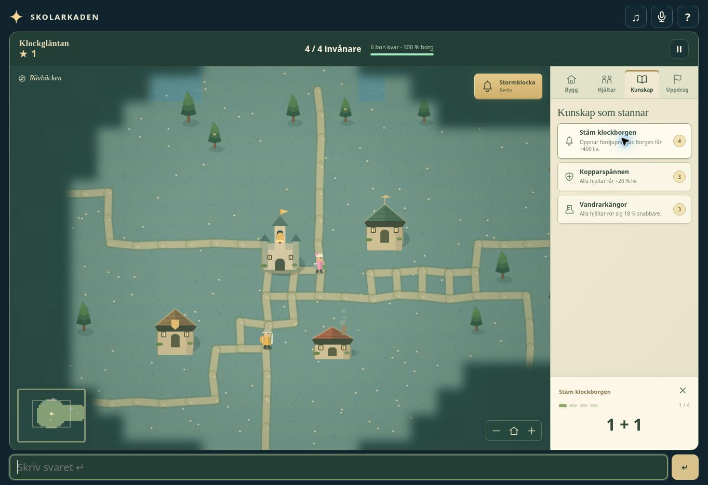

# Klockgläntan: design review and release checks

Reviewed on 2026-10-28 by an independent game-design AI agent, followed by fixes
and a second simulation review. The reviewer inspected the implemented modules
and exercised the real exercise adapter; browser verification was performed separately.

## Findings incorporated

| Finding | Implemented response |
| --- | --- |
| The starter trio won 90/90 runs with only 6–10 cheap answers. | Outer lairs have stronger structures and mixed garrisons that awaken immediately when attacked. Heroes account for those defenders before volunteering. |
| Idle defenders missed attackers on the opposite side of the castle. | Shared village alarms prioritize castle attackers; guards also notice attacks on nearby buildings. |
| Upgrading a marching bounty attracted no reinforcements. | Marching groups accept volunteers, regroup after serious losses or stalled attacks, and explain insufficient strength. |
| A monster entering a plot erased a 7/8 payment. | Temporary obstruction preserves both partial and completed payment, including across reloads. Construction completes once the plot clears. |
| Tower farming produced unlimited score and excessive passive XP. | Kill/XP score contributions are capped. Weak enemies stop teaching veterans; uninvolved tower spectators earn reduced XP, and healing practice has a progression budget. |
| Switching/cancelling actions rerolled difficult questions for free. | An unanswered question survives intent changes. Payment progress still resets. |
| Incremental bounty upgrades charged the entire new reward again. | Upgrades charge only the increase. |

## Balance evidence

The second review found no deadlock in the tested mixed-army runs. Starter-only,
level-one-bounty strategies won 0/30 revised runs. Mixed armies won all ten seeds
at each difficulty, without an eight-answer investment. Gentle was intentionally
forgiving after recruitment; difficult runs sometimes needed resurrection.

The final, checked-in `dev/glantan-balance.cjs` independently reproduces complete
runs through paid answers. Its army has three warriors, two rangers, two healers,
one mage, housing, both missing guilds, armor and boots. Seeds 0–2:

| Difficulty | Seconds per answer | Wins | Correct answers | Run duration |
| --- | ---: | ---: | ---: | --- |
| Gentle | 10 | 3/3 | 35–37 | 7:33–7:43 |
| Gentle | 20 | 3/3 | 34–36 | 13:24–13:56 |
| Brave | 10 | 3/3 | 41–43 | 9:10–10:12 |

All nine runs needed a maximum purchase streak of four. The reviewer separately
tested ten gentle runs at 80% answer success: all finished in 42–64 attempts
before the final bounty-cost reduction. These are automated balance probes,
not a claim that every human strategy or exercise will take the same time.

## Verification

- World tests cover 90 generated maps, reachability and permanent exploration.
- Purchase tests cover capacity, veteran resurrection, permanent branch choices,
  unique investments, placement and incremental bounties.
- Adapter tests cover every exercise family, wrong answers, intent changes,
  question retention, temporary obstruction, realtime, pause and save compatibility.
- Simulation tests cover awakened defenses, village alarms, reinforcements,
  support XP, bounded spreading, final-monster cleanup and castle defeat.
- Shared app tests cover typed purchase delivery, input lifecycle, pause/resume,
  result screens, same-map replay, score version and Worker acceptance.
- The existing 68-suite regression run passed after extending its DOM fixture
  for the new renderer and rerunning the affected suite.
- Browser checks cover house placement/payment, a broken streak, recruitment,
  research unlocks, paid bounties, diagram readability, reload, desktop, 390×844
  portrait and a 390×480 constrained viewport. Controlled development fixtures
  verify victory, defeat and replay without sending synthetic scores online.

## Running only relevant checks

`node tests/games/glantan/run.cjs world orders adapter simulation` accepts any subset
of those four domains. `node tests/games/glantan/app.test.cjs` checks shared app integration;
`node tests/highscores.cjs` checks the score service and upload-failure replay.
Run `node dev/glantan-balance.cjs gentle 10 0 1 2` after balance/AI changes.
Run `node dev/version-assets.cjs` after changing browser assets.

The GitHub Pages game is independent of the separately deployed Cloudflare
score worker. Its updated generated source is included; no SQL migration is
required. Until that Worker is deployed, the new leaderboard reports its
unavailability and replay still works.

## Published verification

[PR #10](https://github.com/JakobRogstadius/Skolarkaden/pull/10) was merged as
`74570b0ac492415c528af92ad7b29a55c0cf6d81`. GitHub Pages deployment run
`40780621721` completed successfully for that commit.

The [public game](https://jakobrogstadius.github.io/Skolarkaden/?game=glantan)
was opened after deployment. Two typed correct answers recruited a warrior
(population 3 to 4); another answer advanced castle research to 1/4. Pausing
worked. The live leaderboard displayed its expected not-ready message; the
separate Cloudflare Worker has not been deployed.

## Follow-up — 2026-10-29

An unfinished saved campaign previously had no restart route: returning to the
menu and starting simply resumed it. The pause screen now offers **Börja om…**,
then **Samma karta** or **Ny karta**. Cancelling preserves the campaign, question
and purchase progress. Abandoned campaigns do not submit scores. A fresh run
is saved immediately, and the overall correct-answer streak now survives reload.

A second independent designer inspected autonomy and casualty recovery and
reproduced two additional bugs:

- A warrior assigned a nearby defensive bounty stayed put while a monster
  attacked the castle. Guarding and gathering parties now respond within the
  existing village-alarm radius without losing their paid assignment.
- After a lair was destroyed and its expedition cleared, a warrior stopped
  retaliating against its surviving guard outside the village radius. Local
  self-defence and protection of nearby allies now remain active; unsolicited
  pursuit is still limited.

The castle-alarm regression failed with the attacker untouched at 82 HP before
the fix. Both defensive assignments and assembling expeditions now kill it in
the nine-second test. A separate aftermath case verifies continued retaliation
after the lair bounty is removed.

The designer independently reran both original reproductions after the fixes:
the paid guard now matches the unassigned control (attacker dead, castle at
989.92 HP), and the surviving guard's HP falls from 83.8 to 35.08 after expedition
release. Separate warrior, healer and mage probes confirm nearby ally protection
respects both distance limits and does not awaken or damage unprovoked distant lairs.

Focused checks: `node tests/glantan/run.cjs adapter simulation`,
`node tests/homework-ui.cjs`, `node tests/check.cjs`,
`node tests/leaderboard-navigation.cjs`, and asset version consistency.
The final paid-answer balance probes cover seeds 0–2 on gentle and brave at
10 seconds per answer, plus gentle seed 0 at 20 seconds: 7/7 victories, requiring
at most a four-answer purchase. Gentle runs take 7:36–7:44; brave 9:15–10:09;
the slower gentle run takes 13:36. This is regression evidence, not a guarantee
for every strategy or learner.

Browser verification covered cancellation retaining a 1/4 research payment,
same-seed restart, a distinct new seed, and the dialog's layout, Escape handling
and restored focus in a constrained 390×480 viewport.

Released in [PR #11](https://github.com/JakobRogstadius/Skolarkaden/pull/11),
merged as `f391ce07e43c2f25fc16dbdc919eb0b801bc3cc3`. Pages run `40821829159`
completed successfully. The public site's new pause controls and same-seed
restart were exercised after deployment. Its leaderboard still reports that
it is not ready for this game; the separate Cloudflare deployment remains pending.
